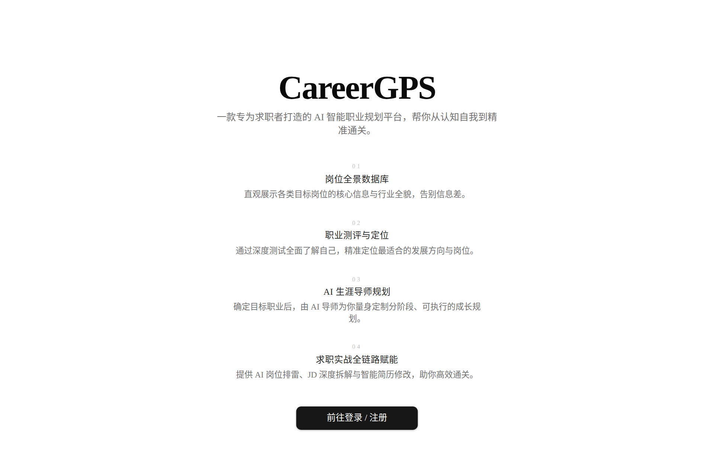

# CareerGPS · AI 职业规划平台

[careergps.chat](https://careergps.chat) · 4 天从需求定义做到上线 · Next.js 15 + Supabase + DeepSeek

一个帮大学生把"迷茫"拆成可执行步骤的小工具：上传简历，说清处境，给出分阶段的行动建议。



## 为什么做这个

做完自己的求职季，发现真正卡住人的不是能力，而是四类**信息差**——产品四个模块就是按这四类设计的：

| 信息差 | 具体表现 | 对应模块 |
|---|---|---|
| 岗位认知 | 知道岗位名字，不知道每天在做什么、招人时看什么 | 01 岗位全景数据库 |
| 自我认知 | 有经历，但说不清哪段对应岗位的哪条要求 | 02 职业测评与定位 |
| 路径规划 | 知道目标，不知道先补哪一块、按什么顺序补 | 03 AI 生涯导师规划 |
| 资质风险 | 不清楚哪些硬性条件（学历、证书、时间）会在投递时直接被筛掉 | 04 岗位排雷 / JD 拆解 |

市面上的工具大多在第三类（给学习路线），前两类和第四类基本没人管——而它们才是"投了没回音"的真实原因。所以产品按这四类组织，而不是按"简历模板/面试题库"组织。

## 它做什么

1. **简历解析**：支持 docx / pdf / 图片（OCR），把一段经历拆成可对照的结构化信息
2. **四类信息差诊断**：逐类给出"你现在缺什么"，而不是笼统的职业建议
3. **6 阶段任务清单**：把诊断结果拆成有先后顺序的动作，每阶段有可验收的产出
4. **流式对话**：围绕当前阶段追问，回答随生成逐字输出

## 关键取舍

**砍掉"企业资质联网核查"。**
最初想做的是"输入公司名，自动查工商信息、经营异常、招聘真实性"。查了一圈发现：可靠数据源要付费，免费接口覆盖不全且不稳定，做出来会给出似是而非的结论——**在"资质风险"这类问题上，给错答案比不给更糟**。所以改为引导用户自己核对哪几项，把不可行的自动化换成可执行的清单。

**登录方案：邮箱验证码 → 短信验证码 → 账号密码。**
邮箱验证码在海外邮箱上送达率不稳（目标用户里有留学生）；短信验证码要企业资质和签名审核，4 天内走不完。最后选账号密码 + Supabase Auth，牺牲一点体验换按时上线。

**先保证主链路，其余留白。**
4 天里只做"简历解析 → 诊断 → 对话"这条主线，社区、岗位库、简历模板全部不做。判断标准很简单：**这条链路断了产品就不成立，其余断了只是少个功能。**

## 技术栈

| 层 | 选型 | 说明 |
|---|---|---|
| 前端 | Next.js 15（App Router）+ React 19 + Tailwind + shadcn/ui | — |
| 后端 | Next.js Route Handlers | 无独立服务，减少部署面 |
| 数据与鉴权 | Supabase（Postgres + Auth） | 行级权限控制用户数据 |
| 模型 | DeepSeek（Vercel AI SDK） | 流式输出，成本低 |
| 简历解析 | mammoth（docx）/ unpdf（pdf）/ tesseract.js（图片 OCR） | 三种格式统一转文本 |

## 本地运行

```bash
npm install
cp .env.local.example .env.local   # 填入 Supabase 与 DeepSeek 的 Key
npm run dev
```

## 已知限制

- 单人开发、4 天工期，只覆盖主链路，没有做社区与岗位库
- 诊断结论由"规则 + 模型"共同生成，模型部分仍有波动，未做系统性评测（这是与另一个 RAG 项目最大的差别）
- 未做付费与多租户，Supabase 免费额度下够个人使用

---

个人项目，非商业产品；建议仅供规划参考。
